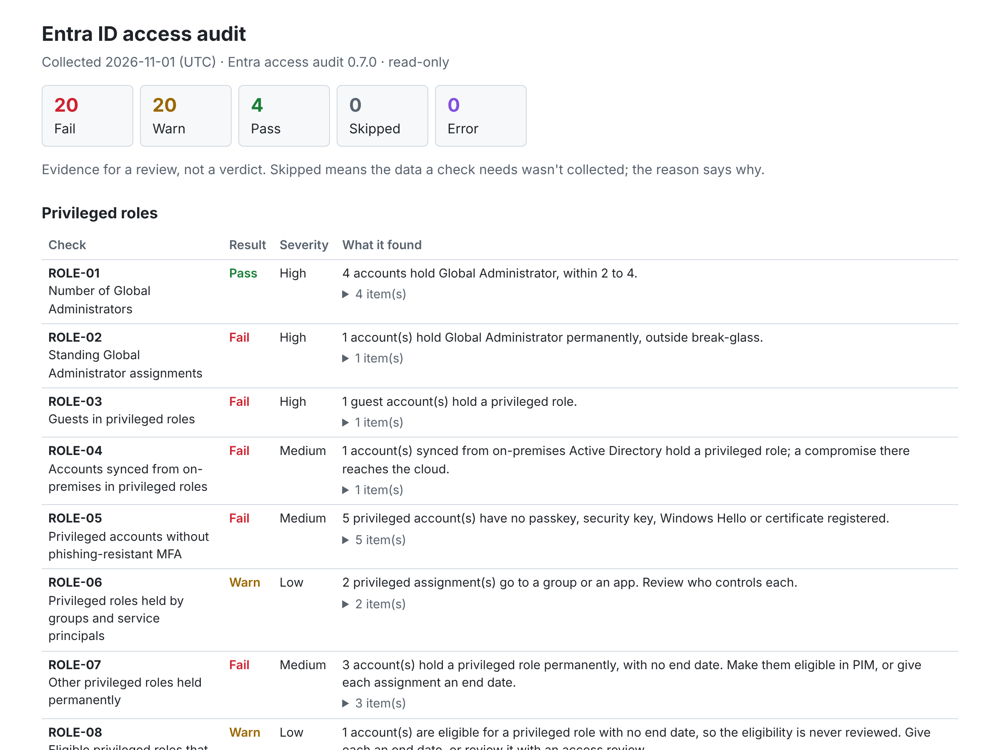
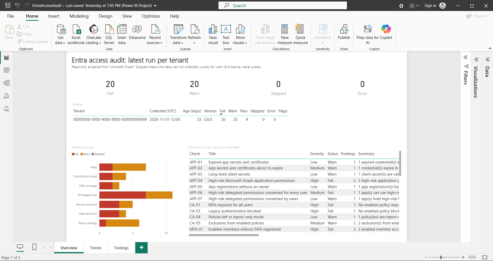

# Entra access audit

A read-only PowerShell audit of who can get into a Microsoft Entra ID tenant,
and how. It reads the tenant through Microsoft Graph and reports on seven areas:

- **Privileged roles:** how many Global Administrators there are, roles held
  permanently or eligible with no end date, roles people granted themselves,
  weak PIM activation rules, roles assigned outside PIM, owners who can add
  themselves to a role-holding group, guests, on-premises synced accounts and
  personal or external accounts in admin roles, and admins without
  phishing-resistant MFA. A role held through a group counts for each
  member of the group.
- **Stale accounts:** enabled members and guests that haven't signed in for 90
  days, accounts that never signed in, and guest invitations nobody accepted.
- **MFA coverage:** members with no MFA registered, accounts that rely on SMS or
  voice alone, and admins without MFA.
- **Apps:** client secrets and certificates that have expired or are about to,
  long-lived secrets, high-risk Microsoft Graph application permissions, app
  registrations with no owner, and high-risk delegated permissions consented
  for every user or by users themselves.
- **Service accounts:** secrets and certificates added to enterprise apps, apps
  in privileged roles, apps from other organizations with high-risk
  permissions, disabled apps that still hold access, and owners who could take
  over an app with high-risk access.
- **Conditional Access:** whether MFA is required for everyone and for admins,
  whether legacy authentication is blocked, policies left in report-only mode,
  and who is excluded from them, directly or through a group.
- **Tenant settings:** whether users can consent to apps, register apps or
  create tenants, what guests can see and who can invite them, whether text
  message and voice call are allowed for sign-in, cross-tenant defaults open
  to every organization, whether the break-glass accounts would work, and
  whether a P1 or P2 trial is about to end.

It writes an HTML report, a CSV with one row per finding, and a JSON file. It
runs on Windows PowerShell 5.1 and PowerShell 7, needs only the
`Microsoft.Graph.Authentication` module, and changes nothing in the tenant.

## Getting started

1. Install the Graph authentication module, once:

   ```powershell
   Install-Module Microsoft.Graph.Authentication -Scope CurrentUser
   ```

2. Download this repository (Code, Download ZIP) and unblock the files, so
   Windows doesn't stop them as downloaded scripts:

   ```powershell
   Get-ChildItem -Recurse | Unblock-File
   ```

3. Run it. A browser window asks you to sign in and to consent to the
   read-only scopes:

   ```powershell
   .\Invoke-EntraAccessAudit.ps1
   ```

The reports go to a `Reports` folder in the current folder. To see what a
report looks like without a tenant, run it on the fictional tenant the tests
use:

```powershell
.\Invoke-EntraAccessAudit.ps1 -FromSnapshot .\tests\fixtures\westmark.snapshot.json -ProfilePath .\tests\fixtures\westmark.psd1
```

## What it changes

Nothing in the tenant. Every request to Microsoft Graph is a GET, sent through
one function, and the tests fail if the script gains another kind of request,
a Graph cmdlet that changes anything, or a scope that isn't read-only. It
writes only its report files, and a snapshot when you ask for one.

## Permissions

| Scope | What it reads |
| --- | --- |
| `User.Read.All` | Users and guests, enabled state, creation date, on-premises sync, invitation state, and where each signs in from (its identities) |
| `AuditLog.Read.All` | Sign-in activity, the MFA registration report, and role changes in the directory audit log |
| `RoleManagement.Read.Directory` | Directory role definitions, assignments, PIM eligibility and schedules, and PIM's activation settings for each role |
| `Application.Read.All` | App registrations and enterprise apps (service principals): their secrets, certificates, owners, publisher and state, and Graph permissions granted to apps |
| `Policy.Read.All` | Conditional Access policies, security defaults, the authorization policy (user consent, default user permissions, guest settings), the authentication methods policy and the default cross-tenant access settings |
| `DelegatedPermissionGrant.Read.All` | Delegated permissions that admins or users consented to for apps |
| `GroupMember.Read.All` | Members and owners of the groups that hold a directory role, and of the groups Conditional Access policies include or exclude |
| `Organization.Read.All` | The tenant's subscriptions: each one's product, state, whether it is a trial, when it next changes state, and the service plans it carries |

`Application.Read.All` also reads the owners of the enterprise apps that hold a
Microsoft Graph permission or a role. For PIM's activation settings Microsoft
lists `RoleManagementPolicy.Read.Directory` as the least privileged scope, but
`RoleManagement.Read.Directory`, which the audit already needs, covers them, so
no scope was added for them.

These are delegated scopes, and the account that signs in also needs a role
that can read this data. **Global Reader** is enough, and is the least
privileged role that covers all of it. An admin may need to consent to the
scopes the first time.

## Licences

Some of this data needs a premium licence:

| Data | Needs | Checks that use it |
| --- | --- | --- |
| Sign-in activity | Microsoft Entra ID P1 | STALE-01, STALE-02, STALE-03, and TEN-06's test sign-in |
| MFA registration report | Microsoft Entra ID P1 | ROLE-05, MFA-01, MFA-02, MFA-03 |
| Conditional Access policies | Microsoft Entra ID P1 | CA-01 to CA-05, and TEN-06's exclusion check |
| PIM eligibility and schedules | Microsoft Entra ID P2 | ROLE-01, ROLE-02, ROLE-07 (see below), ROLE-08, ROLE-10 |
| PIM activation settings | Microsoft Entra ID P2 | ROLE-10 |
| PIM assignment schedules | Microsoft Entra ID P2 | ROLE-12 (without PIM, every assignment is made outside it) |

The directory audit log needs no licence, but Microsoft keeps it for 7 days
without P1 and 30 days with it, so ROLE-09 and ROLE-12 see only that far back and say so.

When the tenant hasn't got the licence, those checks are **Skipped**, and the
report says why. TEN-07 warns before that happens: when a trial is the only
subscription carrying P1 or P2 and ends within `LicenceExpiryDays` (30), it
names the checks that will then be Skipped. It fails when that subscription has
expired or been suspended. Two cases are different:

- Without PIM (P2), ROLE-01 counts active Global Administrators only, and
  ROLE-02 and ROLE-07 count every active assignment as permanent. Each says
  so.
- Without Conditional Access (no P1) and with security defaults off, CA-01 to
  CA-03 **fail**: nothing in the tenant requires MFA or blocks legacy
  authentication. With security defaults on, they pass.

## Checks

| Id | Area | Severity | Title | Reports |
| --- | --- | --- | --- | --- |
| ROLE-01 | Privileged roles | High | Number of Global Administrators | Fail above `MaxGlobalAdmins` (4); Warn below `MinGlobalAdmins` (2). Active and PIM-eligible holders count, break-glass included. |
| ROLE-02 | Privileged roles | High | Standing Global Administrator assignments | Fail for a permanently active Global Administrator that isn't a break-glass account. |
| ROLE-03 | Privileged roles | High | Guests in privileged roles | Fail for a guest holding a privileged role. |
| ROLE-04 | Privileged roles | Medium | Accounts synced from on-premises in privileged roles | Fail for a synced account holding a privileged role. |
| ROLE-05 | Privileged roles | Medium | Privileged accounts without phishing-resistant MFA | Fail for a privileged account with no passkey, security key, Windows Hello or certificate registered. |
| ROLE-06 | Privileged roles | Low | Privileged roles held by groups and service principals | Warn for each, so you can review who controls them. |
| ROLE-07 | Privileged roles | Medium | Other privileged roles held permanently | Fail for a permanently active privileged role other than Global Administrator (ROLE-02), held by a user or through a group, outside break-glass. |
| ROLE-08 | Privileged roles | Low | Eligible privileged roles that never expire | Warn for a PIM-eligible privileged assignment with no end date, outside break-glass. |
| ROLE-09 | Privileged roles | High | Roles granted to oneself | Fail for a role an account added to itself, directly or through PIM, in the directory audit log. PIM activations of one's own eligibility don't count. |
| ROLE-10 | Privileged roles | Medium | Weak PIM activation rules for privileged roles | Warn for a privileged role with eligible accounts whose activation needs no MFA or authentication context, lasts longer than `MaxActivationHours` (8), or, for Global and Privileged Role Administrator, needs no approval. |
| ROLE-11 | Privileged roles | High | Owners of groups that hold privileged roles | Fail for an owner of a role-holding group, who can add themselves to it, unless they are a Global or Privileged Role Administrator or break-glass. |
| ROLE-12 | Privileged roles | Medium | Privileged roles assigned outside PIM | Warn for a privileged role assigned directly, outside PIM, in the directory audit log, leaving out break-glass accounts. |
| ROLE-13 | Privileged roles | Medium | Privileged roles held by personal or external accounts | Fail for a member account holding a privileged role that signs in with a personal Microsoft account or an account from another organization, such as the personal account that created the tenant. Guests are ROLE-03's. |
| STALE-01 | Stale accounts | Medium | Enabled members with no recent sign-in | Fail for an enabled member whose last sign-in is older than `StaleDays` (90). |
| STALE-02 | Stale accounts | Low | Enabled members that never signed in | Fail for an enabled member older than `StaleDays` with no sign-in. |
| STALE-03 | Stale accounts | Medium | Enabled guests with no recent sign-in | Fail for an enabled guest with no sign-in in `StaleDays`. |
| STALE-04 | Stale accounts | Low | Guest invitations never accepted | Warn for an invitation pending longer than `StaleDays`. |
| MFA-01 | MFA coverage | High | Enabled members without MFA registered | Fail for an enabled member with no MFA method registered. |
| MFA-02 | MFA coverage | Medium | Users whose only MFA is a phone call or text | Warn for an enabled account whose only second factor is a phone. |
| MFA-03 | MFA coverage | High | Privileged accounts without MFA registered | Fail for a privileged account with no MFA method registered. |
| APP-01 | Apps | Low | Expired app secrets and certificates | Warn for an expired credential still on an app registration. |
| APP-02 | Apps | Medium | App secrets and certificates about to expire | Warn for a credential expiring within `CredentialExpiryDays` (30). |
| APP-03 | Apps | Low | Long-lived client secrets | Warn for a current secret valid longer than `MaxSecretLifetimeDays` (365). |
| APP-04 | Apps | High | High-risk Microsoft Graph application permissions | Fail for an app granted a permission in `HighRiskPermissions`, unless it is in `AcceptedApps`. |
| APP-05 | Apps | Low | App registrations without an owner | Warn for an app registration with no owner. |
| APP-06 | Apps | Medium | High-risk delegated permissions consented for every user | Fail for an app with tenant-wide consent to a Microsoft Graph permission in `HighRiskPermissions`, unless it is in `AcceptedApps`. |
| APP-07 | Apps | Low | High-risk delegated permissions consented by users | Warn for an app that users consented to a Microsoft Graph permission in `HighRiskPermissions`, naming the users. |
| SVC-01 | Service accounts | Medium | Secrets and certificates on enterprise apps | Warn for a current secret or certificate on an enterprise app, which lets someone sign in as it outside its app registration. SAML signing certificates and managed identities are left out. |
| SVC-02 | Service accounts | High | Service principals in privileged roles | Fail for an app holding a privileged role, directly or through a group, unless it is in `AcceptedApps`. |
| SVC-03 | Service accounts | High | Apps from other organizations with high-risk permissions | Fail for an app published by another tenant (not Microsoft) holding a `HighRiskPermissions` application permission or tenant-wide delegated consent, unless it is in `AcceptedApps`. |
| SVC-04 | Service accounts | Low | Disabled apps that still hold permissions or roles | Warn for a disabled enterprise app that still holds an application permission, a delegated grant or a role. |
| SVC-05 | Service accounts | High | Owners of apps with high-risk access | Fail for an owner of an enterprise app or its app registration, when the app holds a `HighRiskPermissions` application permission or a privileged role, unless the owner is a Global, Privileged Role, Application or Cloud Application Administrator, or break-glass, or the app is in `AcceptedApps`. |
| CA-01 | Conditional Access | High | MFA required for all users | Fail unless security defaults are on, or an enabled policy requires MFA or an authentication strength for all users on all apps. |
| CA-02 | Conditional Access | High | MFA required for administrators | Fail unless security defaults are on, or an enabled policy requires MFA for all users or for Global Administrators on all apps. |
| CA-03 | Conditional Access | High | Legacy authentication blocked | Fail unless security defaults are on, or an enabled policy blocks Exchange ActiveSync and other clients for all users. |
| CA-04 | Conditional Access | Low | Policies left in report-only mode | Warn for each report-only policy. |
| CA-05 | Conditional Access | Medium | Exclusions from enabled policies | Warn for excluded accounts that aren't break-glass, and for excluded roles. For an excluded group, Warn for members that aren't break-glass, a group that isn't role-assignable (Groups, User and Intune Administrators can add anyone to it), owners who can add members, and a group that no longer exists. A role-assignable, ownerless group of break-glass accounts only passes. |
| TEN-01 | Tenant settings | High | Users can consent to apps | Fail when users can consent to any app, or to apps Microsoft flags as risky; Warn for a custom consent policy. Consent for verified publishers and low-impact permissions only, and Microsoft's managed recommended and mail-app policies, pass. |
| TEN-02 | Tenant settings | Medium | Users can register apps or create tenants | Warn for each of these default user permissions that is on. |
| TEN-03 | Tenant settings | Medium | Guest access and invitations | Warn when guests have the same directory access as members, anyone including guests can invite guests, or anyone with a verified email can join. |
| TEN-04 | Tenant settings | Medium | Text message and voice call sign-in methods | Warn for each enabled in the authentication methods policy, and notes when the legacy MFA and SSPR settings still apply. |
| TEN-05 | Tenant settings | Low | Cross-tenant access defaults | Warn when the defaults allow B2B direct connect, or redeem invitations automatically, for every other organization. |
| TEN-06 | Tenant settings | High | Break-glass accounts | Fail for a `BreakGlassAccounts` account that is missing, disabled, synced from on-premises, not an active Global Administrator, or reached by an enforced Conditional Access policy. Warn when one hasn't signed in within 90 days, when it can't be told whether a policy reaches one, and when none or only one is listed. |
| TEN-07 | Tenant settings | Medium | Entra ID P1 or P2 ending | Warn when the only subscriptions carrying P1 or P2 are trials ending within `LicenceExpiryDays` (30), naming the checks that will be Skipped. Fail when they have expired (grace period) or been suspended. A paid subscription's renewal date doesn't count. |

Privileged roles are Global Administrator and the other built-in roles that
can take over the tenant or its security, such as Privileged Role
Administrator, Security Administrator and User Administrator, plus any role
Graph marks privileged. The full list is `$PrivilegedRoles` in the script.

A role assigned to a group counts for each member of the group, so the role
checks and MFA-03 judge each member as if the role were theirs, and name the
group it comes through. ROLE-06 lists the group itself. If the members can't
be read, the group counts as one holder, and ROLE-01 and ROLE-06 say so.
Membership that PIM for Groups makes eligible isn't read yet.

## Usage

```powershell
# Audit the tenant and keep the snapshot, to evaluate again later
.\Invoke-EntraAccessAudit.ps1 -SnapshotPath .\tenant.snapshot.json

# Evaluate a saved snapshot, on any machine, with no sign-in
.\Invoke-EntraAccessAudit.ps1 -FromSnapshot .\tenant.snapshot.json

# Reports somewhere else, and your own thresholds
.\Invoke-EntraAccessAudit.ps1 -OutputPath D:\Audits -ProfilePath .\EntraAccessAudit.local.psd1
```

### Unattended runs

For a scheduled audit, sign in as an app instead of a person. Register an app
in the tenant, grant it the seven permissions above as **Application**
permissions with admin consent, add a certificate to it, and run:

```powershell
.\Invoke-EntraAccessAudit.ps1 -TenantId <tenant ID> -ClientId <app ID> -CertificateThumbprint <thumbprint>
```

The certificate must be in the current user's or the local machine's
certificate store.

## Thresholds

Copy `EntraAccessAudit.example.psd1` to `EntraAccessAudit.local.psd1` beside the
script (git ignores it) and change what you need; the script uses it when it is
there, or the file named by `-ProfilePath`. The example documents each setting:

| Setting | Default | Used by |
| --- | --- | --- |
| `StaleDays` | 90 | STALE-01 to STALE-04 |
| `CredentialExpiryDays` | 30 | APP-02 |
| `MaxSecretLifetimeDays` | 365 | APP-03 |
| `MinGlobalAdmins`, `MaxGlobalAdmins` | 2, 4 | ROLE-01 |
| `MaxActivationHours` | 8 | ROLE-10 |
| `LicenceExpiryDays` | 30 | TEN-07 |
| `BreakGlassAccounts` | none | ROLE-02, ROLE-07, ROLE-08, ROLE-11, ROLE-12, SVC-05, STALE-01, STALE-02, CA-05 leave them out; TEN-06 checks them |
| `AcceptedApps` | none | APP-04, APP-06, APP-07, SVC-01 to SVC-03 and SVC-05 count them but don't list them |
| `HighRiskPermissions` | 16 permissions | APP-04, APP-06, APP-07, SVC-03, SVC-05 |

Name your emergency access (break-glass) accounts in `BreakGlassAccounts`.
They are meant to hold Global Administrator permanently, stay out of
Conditional Access and sign in rarely, so without this they show up as
findings. They still count toward ROLE-01 and still need MFA. TEN-06 checks
them against Microsoft's guidance for emergency access accounts: each exists,
is enabled and cloud-only, holds Global Administrator actively (not only
eligible through PIM), is outside every enforced Conditional Access policy,
directly or through an excluded group or role, and has signed in within 90
days, so you know it works. It warns when fewer than two are listed. Graph's
sign-in activity can take a few hours to show a test sign-in.

A setting the script doesn't know stops the run, so a misspelt one can't be
silently ignored.

## Results

| Result | Meaning |
| --- | --- |
| Fail | The data was collected, and it shows a gap. |
| Warn | The data was collected, and it shows something to review. |
| Pass | The data was collected, and it shows no gap. |
| Skipped | The data the check needs wasn't collected. The reason says why, usually a licence. |
| Error | The check itself failed. The message is in the report. |

Nothing passes by default: a check whose data is missing is Skipped and
counted, never passed. An MFA registration report with no records, in a tenant
that has users, counts as missing: Microsoft fills it in the background, which
can take a day in a new tenant. An account the report has no record for makes
ROLE-05, MFA-01 or MFA-03 Warn, naming it, rather than being left out. Dates are judged against the time the snapshot was
collected, so evaluating an old snapshot gives the same results it did then.

Exit codes: **0** no Fail and no Error; **1** at least one Fail; **2** at least
one Error, a dataset that couldn't be read for a reason other than licensing
(such as a missing scope), or the audit couldn't start.

## Reports

Each run writes three files, named by collection time (UTC):

| File | Contents |
| --- | --- |
| `entra-access-audit-<time>.html` | A self-contained page: counts, every check by area with its findings, the data collected and the thresholds. No scripts, light and dark themes. |
| `entra-access-audit-<time>.csv` | One row per finding, with the check, its result and severity. A check with no findings has one row. |
| `entra-access-audit-<time>.json` | The tenant ID, counts, each dataset's status, the thresholds and every result. The Power BI template reads these. |



The reports name real accounts, guests and apps. Keep them somewhere private.

### Power BI

Keep the JSON reports from each run in one folder, for one tenant or several.
The Power BI template reads every `entra-access-audit-*.json` report in it,
subfolders included, and needs nothing else: no snapshot, no Graph access and
no account. [Power BI Desktop](https://powerbi.microsoft.com/desktop/) is free
and works without signing in.

Download `EntraAccessAudit.pbit` from the [latest release](../../releases/latest)
and open it. Power BI asks for three parameters. The boxes start empty, so
fill in all three:

| Parameter | Suggested value | What it does |
| --- | --- | --- |
| `ReportFolder` | your folder, such as `\\fileserver\entra-audit` | The folder that holds the JSON reports. |
| `StaleDays` | 30 | A tenant's latest run older than this is flagged Stale. |
| `TrendDays` | 180 | Days of runs the Trends page shows. |

The template ships without parameter values, so it can't fill these in. To
change them later, choose Transform data, then Edit parameters. If `ReportFolder`
is left at the example `\\fileserver\entra-audit`, the pages load empty. Any
other folder that can't be read, or that holds no reports, stops the refresh
with a message that says so.

The template has three pages:

- **Overview.** Each tenant's latest run: Fail, Warn, Skipped and Error totals,
  a row per tenant with its counts, age, version and flags (Stale, Errors,
  datasets not collected), checks by area, and the checks to act on, worst
  severity first.
- **Trends.** Pick a tenant. Fail, Warn, Skipped and Error for each run in the
  trend window, and a grid of every check by run (F Fail, W Warn, P Pass, S
  Skipped, E Error). A new release adds checks, and a lapsed licence turns
  checks Skipped, so counts from such runs don't compare one for one; the grid
  shows which checks changed.
- **Findings.** Every finding in the latest runs, with Area, Severity and Result
  slicers, and below it the data each run couldn't collect and why.



Like the audit's own reports, the template shows counts and results, never a
score. Refresh after new runs. The template keeps no data, but a `.pbix` saved
from it does, and it names real accounts and apps, so treat that file like the
reports. Reports from before 0.8.0 have no tenant ID; they show as one tenant,
"(not recorded)".

The template's source is the Power BI project in [powerbi/](powerbi/), plain text
that Power BI Desktop opens directly (`EntraAccessAudit.pbip`).

## Compatibility

- Windows PowerShell 5.1 and PowerShell 7. The tests run on both.
- `Microsoft.Graph.Authentication` 2.x for a live audit. Evaluating a snapshot
  needs no module and runs on any operating system.
- Microsoft Graph v1.0 endpoints only.

## Testing

```powershell
.\Test-EntraAccessAudit.ps1 -BothEditions
.\Test-EntraAccessAuditLint.ps1 -BothEditions
```

The suite needs no tenant and no network. Every check runs against the
fictional Westmark tenant in `tests/fixtures`, with a Fail or Warn case, a Pass
case and a Skipped case each; the collector runs against a fake Microsoft
Graph that pages, refuses licences and denies scopes. A skipped or unrun test
fails the run.

Both scripts end with the same summary block as the JobSweep and endpoint scan
suites, easy to find and to copy: a full-width banner with the script name,
status and pass, fail and skip counts (green when all passed, dark yellow with
skips, red on any failure), the target, run time and PowerShell version, a
table with a row per edition, and a RESULT bar. The test table shows the
fixtures and the passed, failed, skipped and not-run counts; the lint table
shows files linted, findings and blocking findings. A Notes column appears only when a row has
something to explain, such as the tests that failed. A missing edition, or a run
that stops with an error, still prints the summary and counts as a failure.

Pester 6.2.0 and PSScriptAnalyzer 1.25.0 are pinned, and installed for the
current user if missing: from the PowerShell Gallery, then from a second
download site checked against a pinned SHA-256, then from `-PackagePath`.

## How this is built

I build this tool with Claude Code as a pair programmer, under the rules in
[`CLAUDE.md`](CLAUDE.md), and I review every change before it is committed. The
Pester suite runs on Windows PowerShell 5.1 and PowerShell 7, and CI runs it and
PSScriptAnalyzer lint on both editions on every pull request and every push to
`main`. Every release is a signed tag. The audit is read-only (see
[What it changes](#what-it-changes)), and no model runs during an audit: each
result comes from data read from Microsoft Graph. The AI writes drafts; the
tests and I decide what ships.

## Changelog

| Version | Date | Changes |
| --- | --- | --- |
| 0.8.0 | 2026-11-24 | Power BI template. `EntraAccessAudit.pbit` on the Release, built from the Power BI project in `powerbi/`, reads every JSON report in a folder: an Overview of each tenant's latest run, Trends across runs with a grid of every check by run, and every Finding with the data that wasn't collected. No account needed. The JSON report now names the tenant. README screenshots of the HTML report and the template, from the fictional Westmark tenant. Fix: SVC-03 failed Microsoft Graph Command Line Tools as another organization's app when its service principal showed an owner tenant the audit didn't know; Microsoft's documented app IDs for it and Graph Explorer now count as Microsoft's. |
| 0.7.0 | 2026-11-24 | Now with 44 checks. TEN-07 Entra ID P1 or P2 ending: warns before a trial that is the only source of P1 or P2 ends, so a lab or pilot tenant doesn't find out from a report full of Skipped checks, and fails on one that has expired or been suspended. New `LicenceExpiryDays` setting. New scope `Organization.Read.All`, to read the subscriptions; Global Reader still covers it. Snapshot schema 7; on older snapshots TEN-07 is Skipped. |
| 0.6.0 | 2026-11-23 | Now with 43 checks, from testing two break-glass accounts in a lab tenant. TEN-06 fails a break-glass account that an enforced Conditional Access policy reaches, and warns when one hasn't signed in within 90 days. CA-05 names who an excluded group lets through, and flags a group that isn't role-assignable or has owners, or no longer exists. ROLE-13 privileged roles held by personal or external accounts, such as the personal account that created the tenant. Fix: TEN-01 warned that Microsoft's managed consent policies, the default in a new tenant, were custom. No new scope: the groups are read with `GroupMember.Read.All`, and identities with `User.Read.All`. Snapshot schema 6; on older snapshots, TEN-06 and CA-05 say when a group's members weren't collected, and ROLE-13 reads `#EXT#` in the name. |
| 0.5.1 | 2026-11-16 | The test and lint scripts' summary uses the same layout as the JobSweep and endpoint scan suites: one banner line with the script name, status and counts, the target, run time and PowerShell version on their own lines, and a RESULT bar. The table keeps its Suite and Fixtures columns, and shows Notes only when a row has something to explain. Tests for the summary block added. |
| 0.5.0 | 2026-11-16 | Now with 42 checks. New Tenant settings area: TEN-01 user consent to apps, TEN-02 users who can register apps or create tenants, TEN-03 guest access and invitations, TEN-04 text message and voice call sign-in, TEN-05 cross-tenant defaults, TEN-06 break-glass accounts that would fail in an emergency. ROLE-12 privileged roles assigned outside PIM. Fix: ROLE-09 listed a self-grant made outside PIM twice, because PIM logs it a second time. No new scope: the settings are read with `Policy.Read.All`. Snapshot schema 5; on older snapshots TEN-01 to TEN-05 are Skipped. |
| 0.4.1 | 2026-11-13 | Snapshots keep only the four PIM activation rules ROLE-10 reads, with only the fields it reads, so a live snapshot is about a third of the size. |
| 0.4.0 | 2026-11-13 | Now with 35 checks. ROLE-07 other privileged roles held permanently, ROLE-08 eligible privileged roles that never expire, ROLE-09 roles granted to oneself (from the directory audit log), ROLE-10 weak PIM activation rules (no MFA, too long, no approval for Global and Privileged Role Administrator; new `MaxActivationHours` setting), ROLE-11 owners of groups that hold privileged roles, SVC-05 owners of apps with high-risk access. No new scope: the audit log, PIM settings and owners are read with scopes the audit already has. Snapshot schema 4; on older snapshots ROLE-09 to ROLE-11 and SVC-05 are Skipped. |
| 0.3.1 | 2026-11-13 | Writing the CSV report no longer shows a warning that `-NoTypeInformation` is obsolete on newer PowerShell 7 releases. The parameter is passed only on 5.1, which needs it. The test and lint scripts end with a coloured summary banner, table and RESULT bar that copy as plain text, and still print it, as a failure, when a run stops with an error. |
| 0.3.0 | 2026-11-12 | Now with 29 checks. New Service accounts area: SVC-01 secrets and certificates on enterprise apps, SVC-02 apps in privileged roles, SVC-03 apps from other organizations with high-risk permissions, SVC-04 disabled apps that still hold access. No new scope: service principal credentials, publisher and state are read with `Application.Read.All`. Snapshot schema 3; on older snapshots SVC-01, SVC-03 and SVC-04 are Skipped. The HTML report lists areas in check order, so a new area can't be left out. |
| 0.2.0 | 2026-11-10 | Now with 25 checks. Roles held through a group count for each member, read with the new `GroupMember.Read.All` scope. APP-06 and APP-07 report high-risk delegated permissions consented for every user or by users, read with the new `DelegatedPermissionGrant.Read.All` scope. Snapshot schema 2; schema 1 snapshots still evaluate, with the new checks Skipped. Fixes from the first live run: an empty MFA registration report (a new tenant's, before Microsoft fills it) now skips ROLE-05 and MFA-01 to MFA-03 instead of passing them, and accounts with no registration record make those checks Warn, naming them, instead of being left out. |
| 0.1.0 | 2026-11-10 | First release. Read-only audit on Microsoft Graph with 23 checks across privileged roles, stale accounts, MFA coverage, apps and Conditional Access; HTML, CSV and JSON reports; snapshots evaluated offline with `-FromSnapshot`; app-only sign-in with a certificate; thresholds and break-glass accounts in a local profile. Pester suite on a fictional tenant and a fake Graph, on 5.1 and 7. |

## License

Apache-2.0. See [LICENSE](LICENSE).
